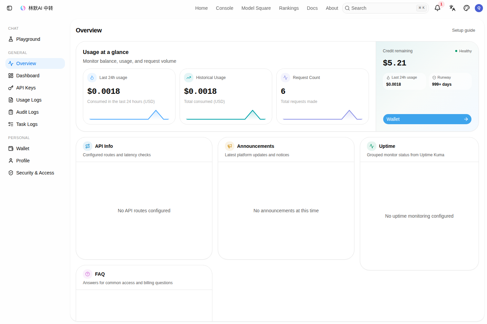
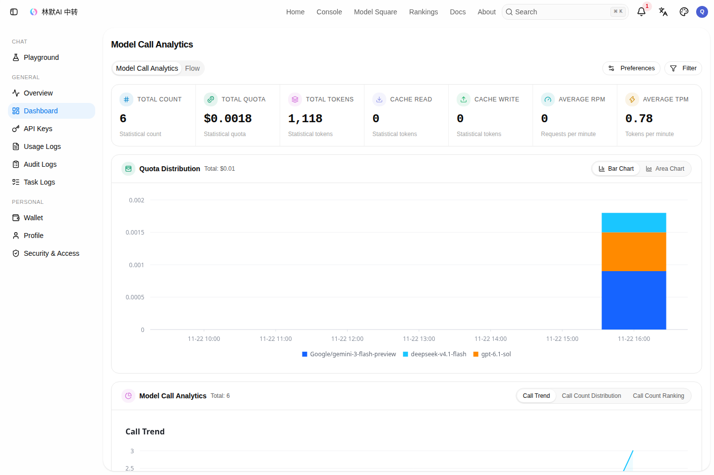
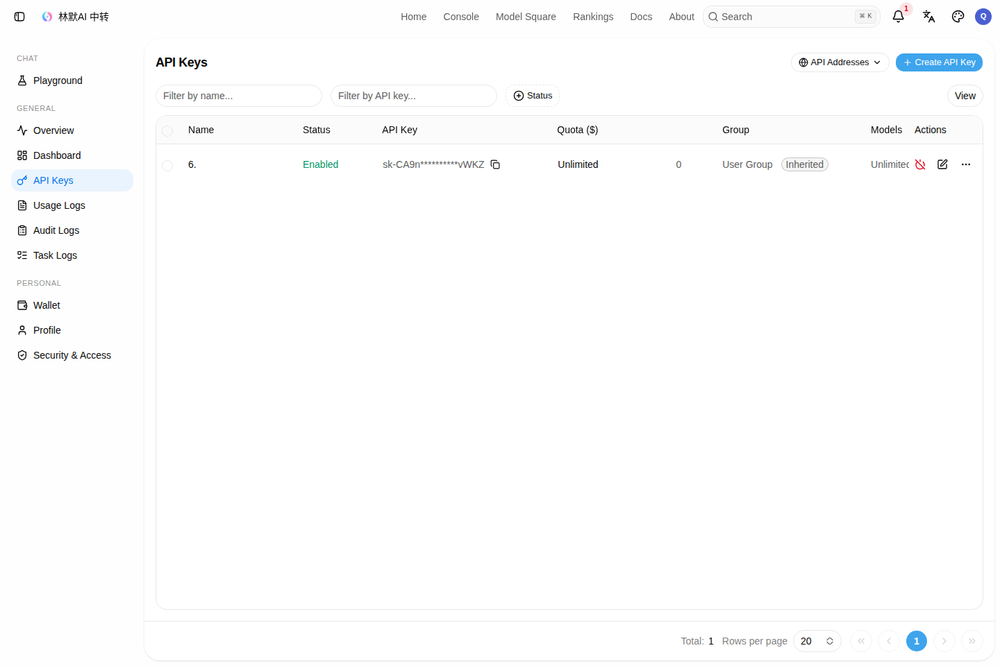
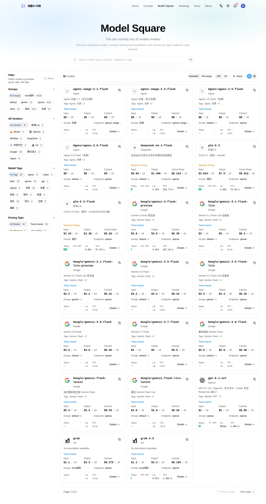
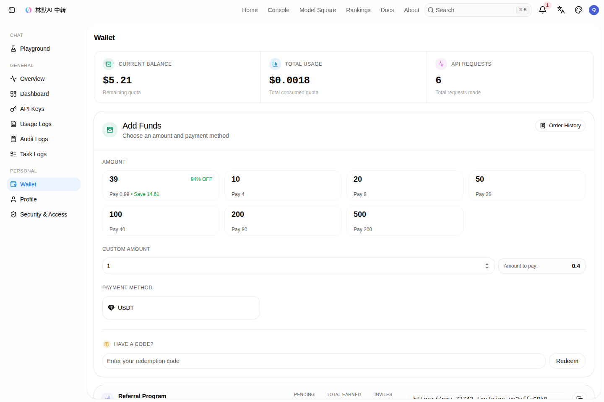
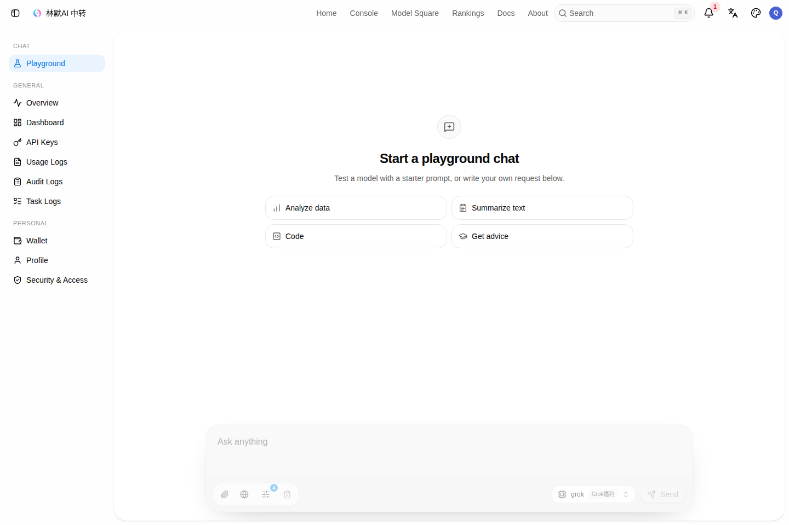
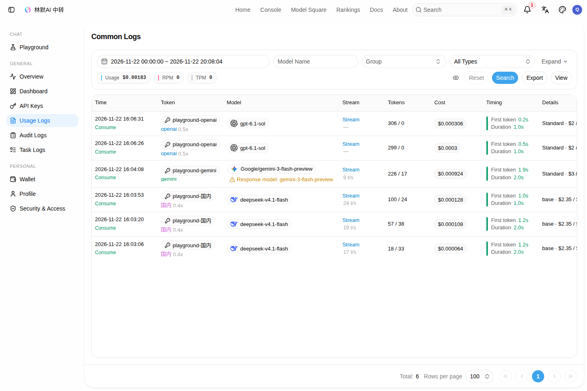
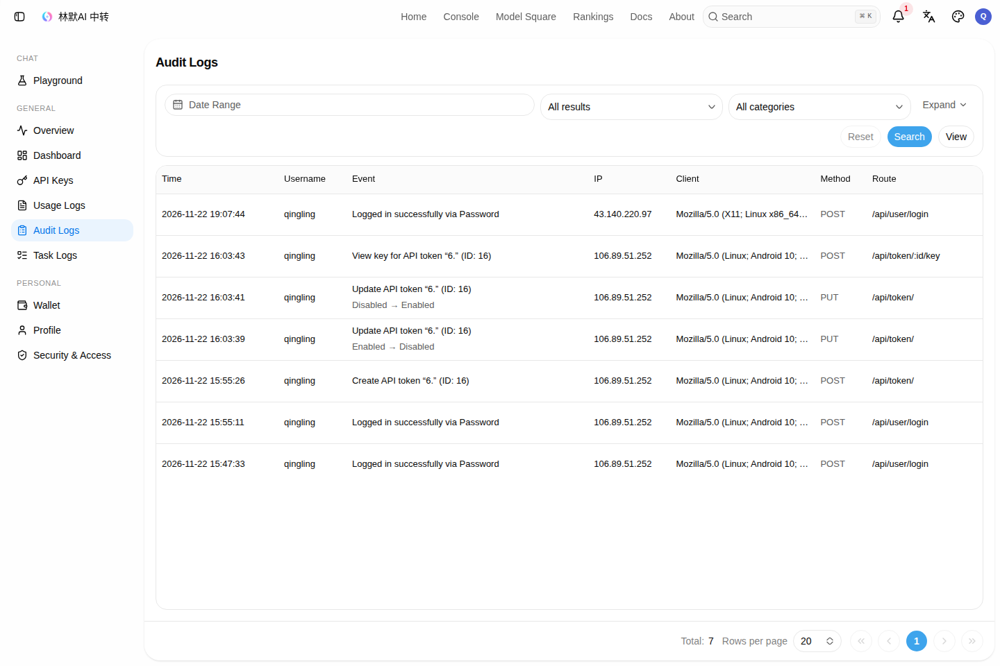
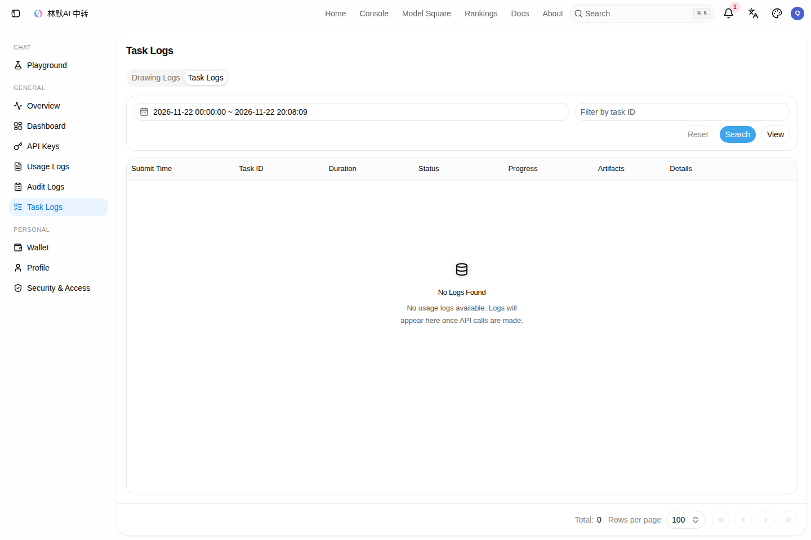
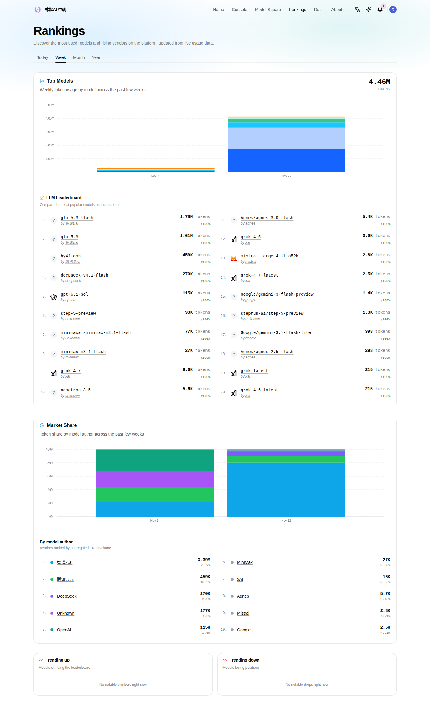

# 林默AI中转 · API 中转服务

> 稳定、便宜、多模型聚合的大模型 API 中转服务。官方接口兼容，改个 Base URL 即可接入，零门槛上手。

## ✨ 为什么选我们

- **真的便宜**：全站默认分组倍率低至 **0.1**，叠加官方价后大部分模型价格远低于官方直连；另有 **Grok 福利分组 0.55 倍率**，长期使用更省。
- **免费模型**：Agnes `agnes-3.0-flash`、`agnes-2.5-flash` 等模型 **ModelRatio=0，完全免费**，延迟低至 0.4s。
- **模型齐全**：聚合 OpenAI / Claude / Grok / Gemini / DeepSeek / MiniMax / Mistral / 阶跃星辰 / 英伟达 / Agnes 等主流厂商，持续更新。
- **稳定可靠**：多线路渠道容灾，实时健康监测，自动切换可用上游。
- **到账自动监听**：USDT 充值链上实时监听，交易哈希全局去重，自动确认到账。
- **非托管收款**：USDT 资金直达自有钱包，不经第三方托管，安全可控。

## 🆓 免费 & 价格

| 项目 | 说明 |
|---|---|
| 免费模型 | Agnes 系列（`agnes-3.0-flash` / `agnes-2.5-flash`）ModelRatio=0，免费可用 |
| 默认分组 | 倍率 **0.1**，远低于官方价 |
| Grok 福利分组 | 倍率 **0.55**，官方价基础上再打折 |
| 计费基准 | 输出/缓存倍率透明，单模型输出单价大多 ≤ 3 元 |

## 🎁 新用户福利

| 福利 | 说明 |
|---|---|
| 注册即送 | 新用户注册成功即赠 **5 美元**余额 |
| 绑定 QQ | 绑定 QQ 账号（机器人绑定）再领额外福利 |
| 首充特惠 | **首充 1.99 元**即可获得 **39 元**额度 |
| 进群福利 | 加入 QQ 群 **710537552** 领取福利与技术支持 |

## 💰 支持的支付方式

| 方式 | 说明 |
|---|---|
| **USDT（加密货币）** | 自建多链 USDT 网关，链上实时监听到账，资金直达自有钱包 |
| **支持链** | TRC20 / ERC20 / Arbitrum / Polygon / BSC(BEP20) / Base |

> BEP20(BSC) 手续费低，推荐使用。USDT 同名但跨链不互通，充值时请选择正确的链。

## 🔧 底层框架

服务端基于成熟稳定的中转框架构建，自研多链支付与到账监听模块：

| 层 | 技术 |
|---|---|
| API 核心 | **new-api**（Go）—— 多模型聚合、分组倍率、计费与渠道调度 |
| 支付网关 | 自建 **NexPay 多链 USDT 网关**（Node.js / TypeScript + React） |
| 到账监听 | 链上 JSON-RPC `eth_getLogs` / TronGrid 每 15 秒轮询，确认数达标自动入账 |
| 数据存储 | SQLite / MySQL |

## 🚀 快速开始

1. 注册账号并登录控制台，创建 API Key。
2. 将客户端 Base URL 改为：
   ```
   https://new.77743.top/v1
   ```
3. 选择模型，按 OpenAI 标准格式调用即可。

## 🖼️ 控制台界面预览

> 以下均为用户控制台真实界面截图（仅展示用户功能，不含任何后台管理操作）。

| 概览 | 模型看板 |
|---|---|
|  |  |

| API 密钥管理 | 模型广场 / 价格 |
|---|---|
|  |  |

| 钱包 / 充值（USDT） | Playground 在线调试 |
|---|---|
|  |  |

| 调用日志 | 审计日志 |
|---|---|
|  |  |

| 任务日志 | 排行榜 |
|---|---|
|  |  |


## 💬 加入交流群

有任何问题、模型需求、充值答疑，欢迎加入官方 QQ 群：

> **QQ 群号：710537552**

进群请备注来意，群内提供模型清单、价格表与技术支持。

## 📮 联系客服

支付后如遇「未到账 / 转错链 / 金额不符」等问题，可在收银台点击「联系客服」，系统会自动附带订单号与金额，或发邮件至：

> **LMaizhongzhuan@foxmail.com**

---

*价格与模型随时更新，最终以控制台实际展示为准。*
